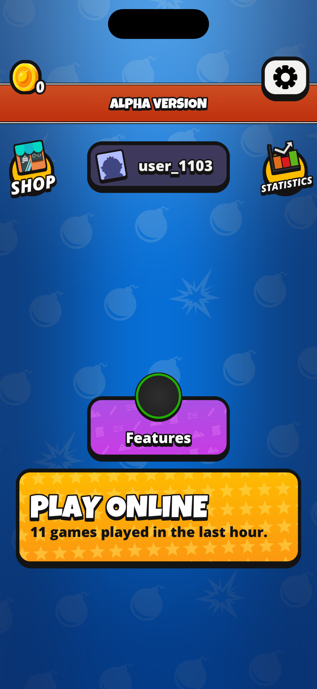
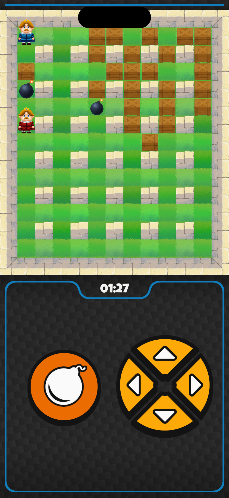
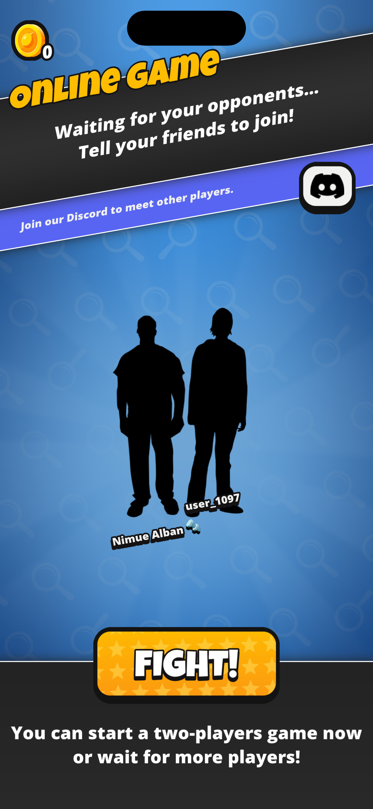

# Bim! for iOS

An iOS port of [Bim!](https://github.com/j-jorge/bim) — an open-source (AGPL-3.0)
multiplayer, last-man-standing arcade game — built from the upstream C++ source at version 17,
the version shipped as `bim-17.apk`.

The Android artefact is a build of the public source tree (see
[`00_recon/REA.md`](00_recon/REA.md)), so this port reuses the game itself, the Axmol engine
it is written against, and all artwork and text, rather than reimplementing them. Only the
platform layer and the app packaging are new.

This is a source-based iOS port, not a conversion of the Android APK; some Android features
are not implemented or verified on iOS.

| lobby | arena | matchmaking |
| --- | --- | --- |
|  |  |  |

## Licence and credits

* Game, artwork, text: **Bim! by J. Jorge** — AGPL-3.0, © the Bim! authors. This port is a
  derivative work under the same licence and ships with the same licence text (`LICENSE`).
  See [`CREDITS.md`](CREDITS.md) for every dependency.
* Engine: **Axmol** `2.11.2.3j` (the `j-jorge` fork the upstream pins).
* Upstream: <https://github.com/j-jorge/bim>. The Discord and donation links belong to the
  author and are untouched.

This is not an official build. If you are looking for the game itself, install **Bim!** from
your store or build upstream — this repository only adds the iOS target.

## State

| stage | status |
|---|---|
| REA of `bim-17.apk` | done — `00_recon/REA.md` |
| Upstream tree pinned at the real version-17 commit | done — `analysis/upstream` @ `cfa6d5a5` (`00_recon/DECISIONS.md` D6) |
| Axmol `2.11.2.3j` built for iOS | done |
| Whole dependency stack (boost, jsoncpp, EnTT, iscool-core, moFileReader) built for iOS | done |
| iOS app target, `Info.plist`, launch screen | done — `01_port/overlay/apps/ios/` |
| Runs in the simulator | done — `03_evidence/lobby-simulator.png` |
| Authenticates, joins a lobby, plays a match, scores it | done — `03_evidence/{matchmaking,game-board,end-of-game}.png` |
| Settings, statistics, nickname editor | done — `BIM_AUTOPRESS` seams, `01_port/TEST_SEAMS.md` |
| Haptics on iOS | done — `iscool/core/system/ios/haptic_feedback.mm` (port patch 0004); needs a phone to feel |
| Music and effects reach OpenAL | done — `audio/menu.ogg` and `audio/tick.ogg` each open a live source (`01_port/TEST_SEAMS.md`); audibility needs a phone |
| Shop / in-app purchases | **not ported** — no StoreKit implementation, so the lobby shows the upstream "not available on this platform" dialog and offers the donation page |
| Home-screen icon | done — the APK's own `ic_launcher`, scaled by `01_port/tools/make-icons.sh`, `03_evidence/home-icon.png` |
| Arm64 device build | done — links and packages; not run on hardware |
| Top row clear of the notch | done — anchors moved in a copy of the style data, `03_evidence/lobby-safe-area.png` |
| Unsigned IPA | `04_release/Bim-unsigned.ipa`, 31.6 MB, arm64, `bim.app` 17/1700, icon set included — also built and published by CI on tag `v17-ios.1` (30.1 MB) |
| CI | `.github/workflows/unsigned-ipa.yml` — green on `v17-ios.1`: builds arm64 from a fresh clone (fetching the pinned sources, `axslcc` and the APK's assets), packages the IPA and publishes it |

Verified on: Hackintosh, macOS 15.5, Xcode 16.0, iOS 18.0 simulator (iPhone 16, x86_64).
Device builds are arm64 and have not been run on hardware. `01_port/DEVICE_TEST.md` is the
ten-step checklist for the phone run, including what each failure would mean.

## Build

Everything is scripted; `01_port/BUILD.md` explains each stage and the traps.
`build/` must stay inside the repository — never work under `/tmp`, which this machine has
already lost once.

```bash
export DEVELOPER_DIR=/Applications/Xcode.app/Contents/Developer

# 0. from a fresh clone: the pinned upstream repositories and the APK's prebuilt assets
#    (analysis/ is ignored, so it does not travel with the repository)
./01_port/tools/fetch-sources.sh

# 1. fetch the pinned upstream tree, overlay the iOS files, apply the patches
./01_port/tools/prepare-tree.sh

# 2. engine, boost, jsoncpp, EnTT, iscool-core, moFileReader (long; ~25 min at JOBS=4)
JOBS=4 ./01_port/tools/build-all.sh

# 3. the app itself, into build/bim-ios-$(uname -m)/apps/ios/Bim.app
JOBS=4 ./01_port/tools/build-app.sh

# 4. run it
xcrun simctl install C5E1129B-3ED4-4BD0-8073-5E1FA6B8A10D \
  build/bim-ios-$(uname -m)/apps/ios/Bim.app
SIMCTL_CHILD_BIM_AUTOPLAY=1 SIMCTL_CHILD_BIM_AUTOFIGHT=1 \
  xcrun simctl launch --console-pty C5E1129B-3ED4-4BD0-8073-5E1FA6B8A10D bim.app

# 5. a device build and an unsigned IPA
ARCHS=arm64 SIMULATOR=FALSE JOBS=4 ./01_port/tools/build-all.sh
ARCHS=arm64 SIMULATOR=FALSE JOBS=4 ./01_port/tools/build-app.sh
./01_port/tools/make-ipa.sh
```

`fetch-sources.sh` pulls the game at `cfa6d5a5`, axmol at `v2.11.2.3j`, iscool-core at `1.31.2`,
jsoncpp `1.9.6`, EnTT `v3.16.0` and fpm `v1.1.1`, then decompiles `bim-17.apk` from the upstream
release with `apktool` to get the assets the port ships. It is idempotent and `prepare-tree.sh`
calls it if anything is missing, so a fresh clone builds with the same three commands the CI
workflow runs.

Nothing is signed: there is no Apple developer identity on this machine. An unsigned IPA
installs through [SideStore](https://sidestore.io/) or
[LiveContainer](https://github.com/LiveContainer/LiveContainer), which re-sign it with your
own Apple ID.

## Testing without touches

An iOS simulator cannot be tapped from outside the app, and this host grants no Accessibility
permission, so the port carries four environment-gated seams that press its own buttons:
`BIM_AUTOPLAY`, `BIM_AUTOFIGHT`, `BIM_AUTORETURN`, `BIM_AUTOPRESS`. They are inert when the
variables are unset. `01_port/TEST_SEAMS.md` documents them and records what they proved.
